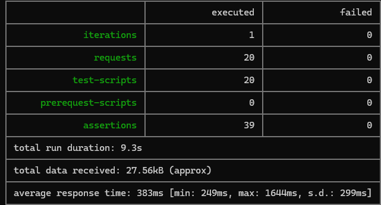

# Restful Booker API Testing

## Project Overview

This project demonstrates REST API testing using Postman against the public Restful Booker demo API. It covers API request validation, automated assertions, authentication, booking management, and negative testing.

## Tools and Technologies

- **Postman** — API requests, collections, and automated test scripts
- **JavaScript** — Post-response test assertions and collection variables
- **Newman** — Command-line collection execution and HTML reporting
- **Restful Booker API** — Public demo API
- **GitHub** — Version control, documentation, and test evidence

## Test Coverage

The collection contains 20 requests covering:

- API health checks
- Authentication and token creation
- Booking creation and retrieval
- Retrieving booking IDs and filtering by query parameters
- Positive and negative test scenarios
- Full and partial booking updates using PUT and PATCH
- Authentication and authorization checks
- Booking deletion and deletion verification
- Automated status-code, response-body, and data validation

## Test Execution

The Postman collection was executed using Newman to run the requests and automated test assertions.

### Latest Execution Results

| Metric | Result |
|---|---:|
| Total requests | 20 |
| Total assertions | 39 |
| Failed tests | 0 |
| Skipped tests | 0 |
| Average response time | 386 ms |
| Total run duration | 9.3 seconds |
| Iterations | 1 |

All 39 assertions passed during this execution, with no failed or skipped tests.

### Test Evidence

- **HTML report:** [View Newman HTML Report](test-reports/Newman-Report.html)

### Newman Test Execution Summary

## Learning Outcomes

This project demonstrates practical experience with:

- REST API testing and HTTP methods
- Request headers and JSON payloads
- Authentication and collection variables
- JavaScript-based automated assertions
- Positive and negative testing
- Command-line test execution using Newman
- Test reporting and evidence documentation

## API Under Test

[Restful Booker Demo API](https://restful-booker.herokuapp.com/)

## Note

This project uses the public Restful Booker demo API for portfolio purposes. Results reflect the recorded execution and may vary between runs because the API is publicly accessible and its data can change.
